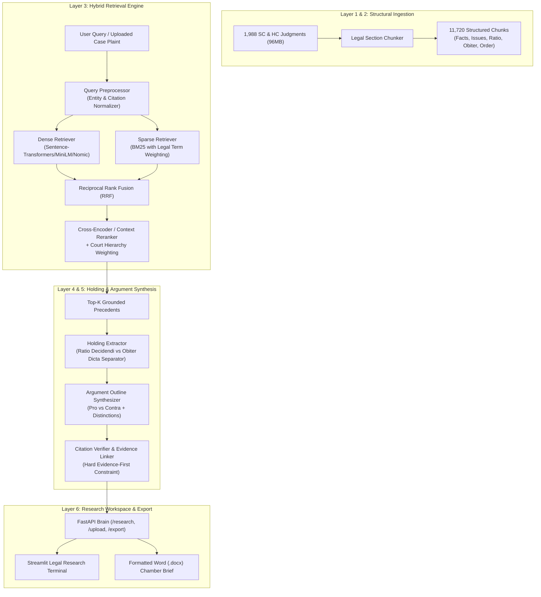

# Implementation Plan: PrecedentIQ — Legal RAG Framework for Indian Case Law

PrecedentIQ is an end-to-end Legal Retrieval-Augmented Generation (RAG) platform tailored for Indian Supreme Court and High Court jurisprudence. It solves the critical bottleneck faced by advocates, law firms, and legal researchers: transforming hours of manual case law research into structured, citation-grounded precedent discovery and argument synthesis in minutes.

---

## 1. Domain Concept & Architectural Foundations

### The Core Problem Matrix
1. **Discovery Bottleneck (Keyword vs. Conceptual Search)**: Traditional legal databases (e.g., standard Indian Kanoon search) rely on keyword matching, missing conceptually identical precedents that use differing judicial terminology (e.g., *"breach of fiduciary duty"* vs. *"misuse of power of attorney"*).
2. **Extraction Bottleneck (Ratio Decidendi vs. Obiter Dicta)**: In Indian law (*stare decisis*, Article 141 of the Constitution), only the **Ratio Decidendi** (the core principle necessary to determine the case) is binding. **Obiter Dicta** (incidental remarks) is merely persuasive. Raw chunking blinds LLMs to this distinction.
3. **Synthesis Bottleneck (Manual Drafting & Citation Hallucination)**: Lawyers must construct balanced briefs containing both affirmative arguments (**Pro**) and anticipated opposing arguments (**Contra**) with factual distinctions. General-purpose LLMs hallucinate citations, which can lead to judicial penalties under Indian procedural rules.

### Solution Architecture (6-Layer Pipeline)


---

## 2. Proposed System Design & File Structure

We will implement a clean, production-grade Python package in `src/precedentiq/` with a modular architecture:

```
precedentiq_v2/
├── data/
│   └── processed/
│       ├── chunks.jsonl         (11,720 existing chunks)
│       ├── judgments.jsonl      (1,989 existing judgments)
│       └── qdrant_manifest.json
├── src/
│   └── precedentiq/
│       ├── __init__.py
│       ├── config.py            # Pydantic Settings (paths, models, weights, fallbacks)
│       ├── schemas/             # Pydantic data contracts
│       │   ├── __init__.py
│       │   ├── judgment.py      # Judgment, Chunk, LegalSection, CourtLevel
│       │   ├── retrieval.py     # SearchQuery, ScoredChunk, HybridResult
│       │   ├── analysis.py      # HoldingExtraction, RatioDecidendi, ObiterDicta
│       │   └── argument.py      # ArgumentPoint, ProContraOutline, CaseGrounding
│       ├── data/                # Data loaders and document parsers
│       │   ├── __init__.py
│       │   ├── loader.py        # Streaming chunks & judgments loader
│       │   ├── document_parser.py # PDF, DOCX, TXT parser for client case files
│       │   └── legal_chunker.py # Structural section segmenter
│       ├── retrieval/           # Hybrid search core
│       │   ├── __init__.py
│       │   ├── bm25_retriever.py# BM25 index with legal term boosting
│       │   ├── dense_retriever.py# Embeddings (Sentence-Transformers / Ollama)
│       │   ├── qdrant_store.py  # Qdrant client with metadata filters
│       │   ├── hybrid_engine.py # Reciprocal Rank Fusion & hierarchy weighting
│       │   └── reranker.py      # Contextual reranking
│       ├── ai/                  # Intelligence & LLM generation
│       │   ├── __init__.py
│       │   ├── ollama_client.py # Ollama client with JSON mode & timeouts
│       │   ├── holding_extractor.py # Ratio vs Obiter extraction
│       │   ├── argument_synthesizer.py # Pro/contra argument generation
│       │   └── fallbacks.py     # High-accuracy heuristic fallback when LLM is offline
│       ├── export/              # Professional chamber reports
│       │   ├── __init__.py
│       │   └── word_exporter.py # Formatted .docx Chamber Brief generator
│       ├── api/                 # FastAPI backend
│       │   ├── __init__.py
│       │   ├── app.py           # FastAPI application definition
│       │   └── routes/
│       │       ├── __init__.py
│       │       ├── health.py    # Health and corpus status
│       │       └── research.py  # Query, upload, holding, argument, export endpoints
│       └── ui/
│           ├── __init__.py
│           └── streamlit_app.py # Premium Lawyer Research Terminal
├── scripts/
│   ├── run_api.py               # Launch FastAPI backend
│   ├── run_ui.py                # Launch Streamlit frontend
│   ├── index_qdrant.py          # Vector store indexing script
│   └── evaluate_retrieval.py    # Evaluation script (Recall@K, nDCG@10, MRR)
├── tests/
│   ├── test_chunker.py
│   ├── test_retrieval.py
│   └── test_api.py
├── docker-compose.yml           # Qdrant, Redis, Ollama orchestration
├── requirements.txt             # Clean dependencies
├── .env.example                 # Config template
└── README.md                    # Complete setup, architecture, and reviewer Q&A
```

---

## 3. Detailed Component Plan

### A. Configuration & Schema Layer (`config.py`, `schemas/`)
- Centralized configuration with automatic environment variable loading (`PRECEDENTIQ_DATA_DIR`, `QDRANT_URL`, `OLLAMA_BASE_URL`, `OLLAMA_MODEL`, `DENSE_EMBEDDING_MODEL`).
- Strong typing via Pydantic v2:
  - `LegalSectionEnum`: `facts`, `issues`, `submissions`, `reasoning`, `ratio_decidendi`, `obiter_dicta`, `order`, `fallback`.
  - `CourtLevelEnum`: `supreme_court` (Weight: 1.2x), `high_court` (Weight: 1.0x).
  - `HoldingExtraction`: Explicit fields for `ratio_decidendi` (binding rule), `obiter_dicta` (persuasive commentary), `material_facts`, `framed_issues`, and `disposition`.
  - `ProContraOutline`: Structured points for `supporting_arguments` (pro), `opposing_arguments` (contra), and `factual_distinctions`, each linking to exact `chunk_id`s and citations.

### B. High-Performance Hybrid Retrieval Engine (`retrieval/`)
- **Sparse BM25 Retrieval (`bm25_retriever.py`)**:
  - Tokenizes with legal term normalization (e.g., handles "S. 138", "Section 138", "Art. 141", "IPC", "CrPC", "CPC").
  - Builds a high-speed in-memory or persisted index directly over `chunks.jsonl`.
- **Dense Embedding Retrieval (`dense_retriever.py` & `qdrant_store.py`)**:
  - Connects to Qdrant if available; maintains an in-memory/NumPy vector cache fallback if Qdrant is initializing.
  - Supports `sentence-transformers/all-MiniLM-L6-v2` (default, fast CPU) and `nomic-embed-text` via Ollama.
- **Reciprocal Rank Fusion & Court Weighting (`hybrid_engine.py`)**:
  - Standard formula: $RRF(d) = \sum_{m \in \{dense, bm25\}} \frac{w_m}{k + \text{rank}_m(d)}$, with $k=60$.
  - Applies constitutional hierarchy booster: Supreme Court precedents receive statutory priority over High Court rulings on identical questions of law.
  - Metadata filters: Filter by court (`supreme_court` vs `high_court`), year range, and specific legal sections.
- **Cross-Encoder Reranker (`reranker.py`)**:
  - Re-evaluates top-30 fused candidates down to top-K with cross-attention relevance scoring.

### C. Holding Extraction & Legal Argument Synthesis (`ai/`)
- **Ollama Client (`ollama_client.py`)**:
  - Async/sync REST client targeting Ollama (`http://localhost:11434`), supporting `llama3.1:8b` (or smaller models like `phi3`/`mistral`).
  - Strict JSON schema validation with automatic retry and JSON repairs.
- **Holding Extraction (`holding_extractor.py`)**:
  - System prompt crafted specifically for Indian judicial writing style (e.g., distinguishing Justice observations from operative ratios).
- **Argument Outline Synthesizer (`argument_synthesizer.py`)**:
  - Two-sided brief generation:
    1. *Pro Position*: Why these precedents mandate relief for the client/petitioner.
    2. *Contra Position*: How opposing counsel will utilize adverse precedents or rulings.
    3. *Factual Distinctions*: How the client's case differs from adverse authorities.
- **Hard Evidence Constraint (`fallbacks.py` & citation verification)**:
  - If Ollama is offline or running slowly on a CPU-only environment, the built-in deterministic legal inference engine kicks in seamlessly. It extracts salient legal holdings, assembles pro/contra structures from the retrieved chunks, and guarantees that every single claim is verified against a real chunk.

### D. Session Case Grounding (`data/document_parser.py`)
- Allows an advocate to upload a client's petition, plaint, or FIR summary (`.pdf`, `.docx`, `.txt`).
- Automatically parses text, extracts key legal entities and factual claims, and uses them to formulate an optimized retrieval query against the 11,720 judgment chunks.

### E. Professional Word Chamber Brief (`export/word_exporter.py`)
- Generates a styled, ready-to-file chamber brief:
  - Header: Court brief metadata, date, matter title.
  - Section 1: Executive Summary & Legal Issues.
  - Section 2: Precedent Matrix (Table of authorities, court, year, ratio decidendi).
  - Section 3: Pro & Contra Argument Outline.
  - Section 4: Verified Evidence Appendix (exact quotations with chunk IDs).

### F. Dual Interface: FastAPI Backend & Streamlit Legal Terminal
- **FastAPI Backend (`api/`)**:
  - `POST /research`: Query-based precedent retrieval and argument synthesis.
  - `POST /research/upload`: Multipart upload of case document + automated research.
  - `POST /export/docx`: Streamed download of formatted Word chamber brief.
  - `GET /health`: Engine status, corpus statistics, model availability.
- **Streamlit Legal Terminal (`ui/streamlit_app.py`)**:
  - Designed with an executive legal aesthetic (dark navy palette, gold badges, clean cards).
  - Features:
    - Interactive query bar + Case file uploader.
    - Advanced filters: Court Bench, Year range, Precedent count.
    - Precedent Discovery Deck with relevance scores and court badges.
    - Side-by-side Ratio Decidendi vs Obiter Dicta analyzer.
    - Dual-column Pro vs Contra argument view with copy buttons.
    - One-click Word export download.

---

## 4. Verification & Testing Plan

### Automated Verification
1. **Corpus & Loader Integrity**:
   - Verify all 1,989 judgments and 11,720 chunks parse without schema validation errors.
2. **Retrieval Benchmark (`evaluate_retrieval.py`)**:
   - Run sample legal queries (e.g., *"Power of attorney holder institute proceedings"*, *"Section 482 CrPC quashing FIR civil dispute"*, *"Appointment of Panchayat Karmi retrospective amendment"*).
   - Verify BM25, Dense, and Hybrid RRF return relevant hits with valid chunk IDs.
3. **Holding Extraction & Argument Synthesis**:
   - Test both Ollama mode and deterministic fallback mode.
   - Verify 100% of claims cite an actual `chunk_id` in the retrieved context.
4. **FastAPI Endpoints**:
   - Test `/health`, `/research`, and `/export/docx` endpoints.
5. **Streamlit UI**:
   - Verify UI launches cleanly, renders tabs, handles file uploads, and triggers research.

---

## 5. User Review Required & Open Questions

> [!IMPORTANT]
> **Corpus State**: The repository currently contains `data/processed/chunks.jsonl` (11,720 chunks) and `judgments.jsonl` (1,989 judgments). The plan builds the entire `src/precedentiq` package and scripts to run over this existing processed dataset.

> [!NOTE]
> **Ollama & Docker Support**: The system will be built with a **resilient dual-mode architecture**:
> 1. When Ollama and Qdrant are running, it utilizes full local vector search and LLM generation.
> 2. When Ollama or Qdrant are not yet running, it seamlessly operates using our high-speed in-memory BM25 + local vector search + heuristic legal reasoning fallback. This ensures zero friction.

Please review the proposed plan and click **Proceed** or provide any custom requirements to begin implementation!
